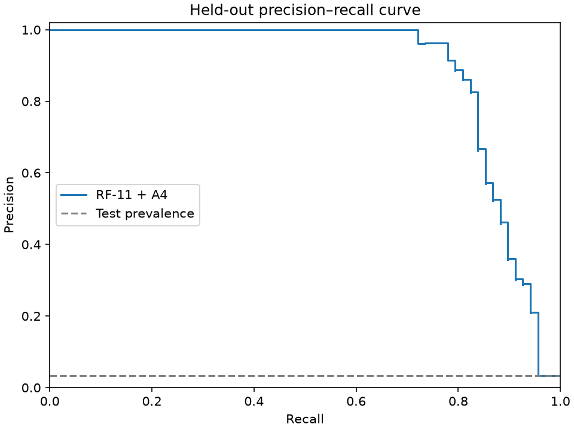
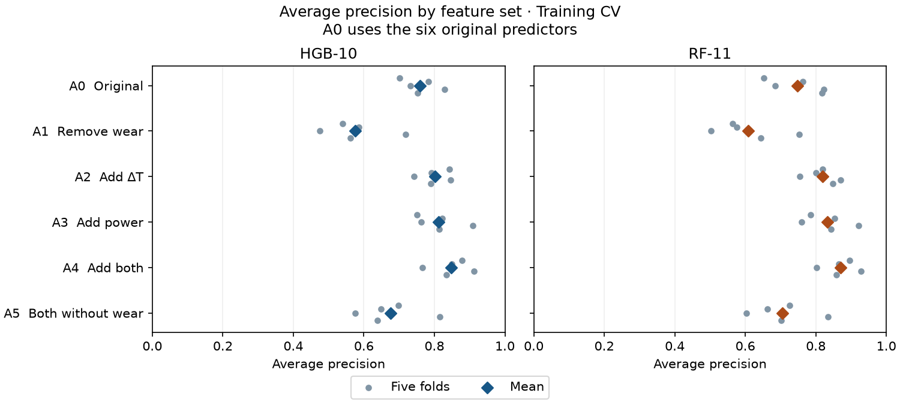

# Explainable Machine Learning for Equipment Failure Classification

A random forest identified **58 of 68 failures** in 2,000 held-out synthetic operations from the UCI AI4I 2020 dataset. At the validation-selected cutoff of **0.15**, it also raised **42 false alarms**. Average precision (AP) was **0.8799**. The study examines why supplying two mechanical quantities improves tree classifiers, which measurements influence their predictions, and how the ranking translates into an inspection workload.

[Technical report (PDF)](report/final_report.pdf) · [Report with links to evidence](report/final_report.md) · [Publication inventory](report/publication_inventory.md) · [Scientific integrity audit](report/scientific_integrity_audit.md)

## Held-out performance

The test partition contained 68 positive and 1,932 negative observations. Both forest rows describe the same ranking. Validation fixed the alert cutoff before test access.

| System and cutoff | AP | Precision | Recall | F1 | F2 | True alerts | False alerts | Missed |
| --- | ---: | ---: | ---: | ---: | ---: | ---: | ---: | ---: |
| RF-11 + A4 at 0.15, primary | 0.8799 | 0.5800 | 0.8529 | 0.6905 | 0.7796 | 58 | 42 | 10 |
| RF-11 + A4 at 0.50, diagnostic | 0.8799 | 0.9800 | 0.7206 | 0.8305 | 0.7609 | 49 | 1 | 19 |
| HGB-10 + A0 at 0.50, descriptive reference | 0.8302 | 0.7067 | 0.7794 | 0.7413 | 0.7637 | 53 | 22 | 15 |

The primary 95% percentile bootstrap intervals were **[0.810543, 0.941731] for AP** and **[0.764706, 0.926471] for recall**. Switching from the diagnostic cutoff to the primary cutoff doubled the alert count from 50 to 100 and recovered nine more failures. F2 favored the primary cutoff and F1 favored the diagnostic. [Exact metrics](results/07_final_evaluation/test_metrics.json) · [Interval record](results/07_final_evaluation/bootstrap_intervals.json)



*The forest's precision–recall curve over the reserved 2,000 operations. The decision at 0.15 was chosen on a separate validation sample with the same 3.4% prevalence.*

## Study design and findings

**Training.** The frozen stratified split allocated 6,000 of 10,000 operations to training. Five shared training folds supported baseline comparisons, model search and paired feature ablations. The six allowed predictors were product type, two temperatures, speed, torque and tool wear. Identifiers and failure-mode flags were excluded. Fold-local preprocessing kept evaluation rows out of fitting. [Data provenance](docs/dataset.md) · [Leakage controls](docs/leakage_risks.md)

**Representation.** A prior-only score achieved 0.0338 mean fold AP and logistic regression reached 0.4586. On the original columns (A0), histogram gradient boosting led the forest, 0.7598 to 0.7480. Adding process minus air temperature and mechanical power (A4) raised their means to 0.8482 and 0.8698 respectively. Both quantities occur in the synthetic failure rules. The forest led across three shuffled training assignments, although boosting with A4 led on two of three individual UDI-ordered blocks. [Ablation comparison](results/04_feature_ablation/figures/ap_comparison.png) · [Robustness comparison](results/06_robustness_analysis/figures/strategy_ap.png)



*Both tree families gained when the simulator's temperature gap and shaft power were available together (A4). Removing tool wear reduced their mean AP even with both quantities present (A5). Each point represents a training-fold result or its five-fold mean.*

**Explanation.** Shuffling torque caused the largest mean AP loss for all four configurations. Tool wear had the largest mean absolute SHAP value in both models examined on one training evaluation fold. The former measures loss of ranking performance after perturbation. The latter describes how individual outputs depart from a baseline. [Permutation results](results/05_explainability/figures/permutation.png) · [Forest SHAP results](results/05_explainability/figures/M4_global.png)

**Validation and test.** The final protocol designated RF-11 + A4 as primary. On validation, 0.15 uniquely maximized F2 over 19 approved cutoffs, detecting 61 of 68 failures with 32 false alerts. The fitted systems and cutoff were then used for the one-time test evaluation. [Validation decision](results/07_final_evaluation/validation_decision.json) · [Execution record](results/07_final_evaluation/execution_manifest.json)

## Research phases

| Phase | Evidence |
| --- | --- |
| [01 · Data exploration](research/01_data_exploration/README.md) | Source audit, split membership and training distributions |
| [02 · Baselines](research/02_baseline_evaluation/README.md) | Training-fold metrics, prior-only and logistic baselines |
| [03 · Model selection](research/03_model_selection/README.md) | Candidate rankings and matched class-weight comparisons |
| [04 · Feature ablations](research/04_feature_ablation/README.md) | Six feature sets and paired fold contrasts |
| [05 · Explainability](research/05_explainability/README.md) | Permutation losses, SHAP scales and local diagnostic cases |
| [06 · Robustness](research/06_robustness_analysis/README.md) | Three shuffled assignments and three ordered evaluations |
| [07 · Final evaluation](research/07_final_evaluation/README.md) | Frozen specification, validation decision, test metrics and uncertainty |

## Reproducibility

The report can be checked from the saved aggregates. Compare SHA-256 digests using the Phase 07 guide, then consult the metric definitions and the stored precision–recall coordinates. This review needs neither the raw dataset nor a fitted pipeline. The original execution used Python 3.12.16 and scikit-learn 1.9.1. [Checksum instructions](research/07_final_evaluation/README.md) · [Locked environment](uv.lock)

For software checks, use a fresh source checkout containing the publication files and no local data exports. From the repository root:

```sh
uv python install
uv sync --locked
uv pip install --require-hashes -r configs/05_shap_requirements.txt
uv run --locked pytest -q
uv run --locked ruff check .
uv run --locked ruff format --check .
```

### Replay the published training studies

The original training-only reproduction instructions and input requirements are in the phase guides above. Baseline and selection verifiers compare fold scores, ablations compare paired differences, and the explanation and robustness verifiers check their respective training artifacts. For this completed study, the [artifact inventory](report/publication_inventory.md) identifies the evidence needed for a read-only review.

## Interpretation and attribution

AI4I describes concurrent synthetic operations. The identifiers provide neither a verified equipment history nor a forecast horizon. Reusing training folds for selection can inflate the best training estimate. The test intervals condition on the fitted forest, fixed cutoff and observed prevalence. Claims about causal mechanisms, warning lead time and the value of deployment would require field evidence.

The tables, figures and derived quantities use the *AI4I 2020 Predictive Maintenance Dataset* (2020), UCI Machine Learning Repository, licensed CC BY 4.0. Stephan Matzka introduced the dataset in 2020. Cite the dataset and project software separately. The source code is licensed under the MIT License. [Dataset DOI](https://doi.org/10.24432/C5HS5C) · [Original publication](https://doi.org/10.1109/AI4I49448.2020.00023) · [Dataset license](https://creativecommons.org/licenses/by/4.0/) · [Software citation](CITATION.cff) · [MIT license](LICENSE)
