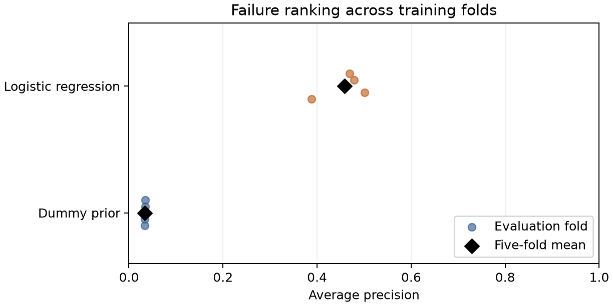
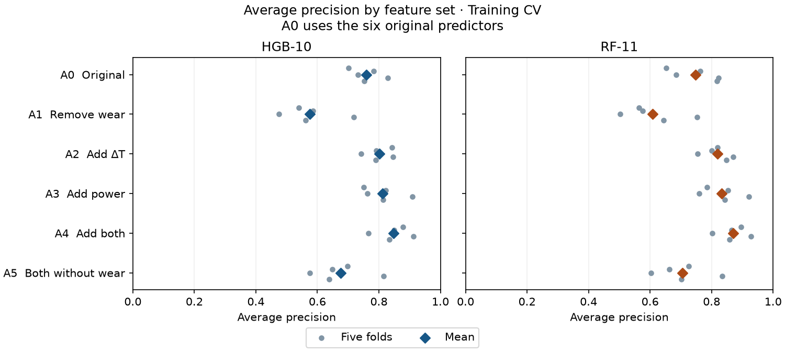
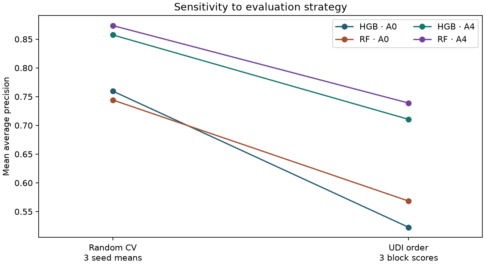
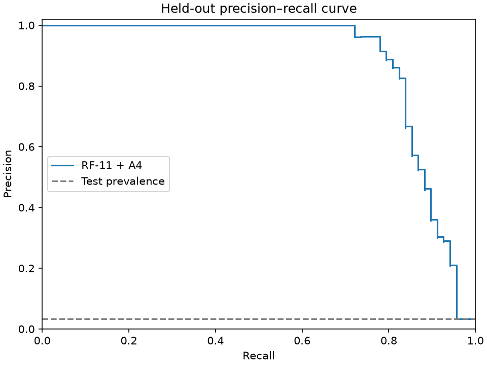

# Explainable Machine Learning for Equipment Failure Classification

Seyedhadi Mousavi · Independent technical report · November 2026

## Abstract

Can a classifier identify a rare equipment failure from measurements taken during the same operation? This study used 10,000 synthetic AI4I operations to compare model families, examine the contribution of two mechanical quantities, and evaluate a decision rule fixed before test access. On the original six predictors, histogram gradient boosting ranked failures highest in training cross-validation. Adding temperature difference and mechanical power produced the largest gain for a random forest. The final forest achieved average precision (AP) of 0.8799 on 2,000 held-out operations. At the validation-selected cutoff of 0.15, it flagged 100 operations, identifying 58 of 68 failures. At the diagnostic cutoff of 0.50 it flagged 50, identifying 49 failures. The difference quantifies the extra inspections associated with greater sensitivity. Both engineered quantities enter the simulator's failure rules. Their value in this benchmark therefore has a specific interpretation and transfer to real equipment remains an empirical question.

## 1. Introduction and research questions

Torque and rotational speed together describe the mechanical power transmitted by a shaft. Likewise, the temperature of a process relative to its surroundings can be more informative about heat dissipation than either reading alone. A tree classifier receives each measurement in a separate column. An engineering question follows naturally. How much does giving the classifier these relationships explicitly change its ability to recognize an operation labelled as a failure?

The study asked three questions. First, how well do increasingly flexible models rank failures above ordinary operations, and how does class weighting affect that ranking? Second, do gains from engineered features persist across training partitions, and which measurements do the fitted models rely on? Third, when a recall-oriented cutoff is chosen on validation data, how many failures and false alarms result on a reserved sample? The first two questions informed model design. Answering the third required keeping both model and cutoff fixed.

## 2. Dataset and problem formulation

Matzka introduced AI4I as a synthetic dataset for predictive maintenance [1, 2]. Each row describes one operation. The binary target is its recorded machine-failure label. The original predictors (A0) are product type, air and process temperatures in kelvins, rotational speed in rpm, torque in N·m and tool wear in minutes. The study excluded the row identifier UDI, Product ID and the five failure-mode indicators. In particular, a failure-mode flag would give the classifier information about the outcome itself. The saved source audit counted 339 failures in 10,000 rows and found no missing cells. All observations were retained. [Dataset audit](../results/01_data_exploration/audit.md)

UCI describes synthetic mechanisms for tool wear, insufficient heat dissipation, power outside an allowed range, overstrain and random failure [1]. Some rules combine several readings. Overstrain, for example, depends on wear and torque with a product-type-specific limit. The measured inputs thus capture some mechanisms more directly than others. The data provide neither verified equipment histories nor a time interval between measurement and failure. The estimand throughout is performance on the contemporaneous label.

## 3. Experimental methodology

A seeded, stratified split allocated 6,000 operations to training (203 failures), 2,000 to validation (68) and 2,000 to test (68). Exploratory analysis and model comparisons used the training partition. The original five stratified folds each held out 1,200 rows, including 40 or 41 failures. Models were compared on identical evaluation rows in each fold. Categorical encoding and, for logistic regression, numeric scaling were learned within the fit portion. Mean fold AP gave each fold equal weight. Using common folds makes paired differences interpretable because the failures available to both candidates are the same. [Training protocol](../docs/research_protocol.md)

Accuracy would give an always-negative rule 96.6% on the reserved sample while it missed every failure. AP measures whether high scores concentrate failures near the top of the ranking. Scikit-learn sums precision at successive recall increments, weighted by the size of each increment [3, 4]. A constant score yields AP equal to prevalence. AP requires no decision cutoff, which allowed the ranking comparison to precede any choice about alert volume. Precision and recall at a fixed cutoff subsequently answer two aspects of those alerts, the fraction that were failures and the fraction of all failures found.

Training CV served to screen candidates and representations. After the design was fixed, the primary and reference pipelines were fitted on the original training partition. Validation served only to choose the primary operating point. The protocol specified a decision when the class-1 score reached or exceeded the cutoff, and reserved one test score vector per system. The fitted pipelines carried through to test without a post-validation refit. [Final protocol](../docs/07_final_evaluation_protocol.md)

## 4. Model comparison and selection

The prior-only baseline achieved 0.0338 mean fold AP. Unweighted logistic regression reached 0.4586. For each tree family, the search paired six sampled structures with unweighted and balanced fits on the six original predictors. HGB-10 led the search with mean fold AP of 0.7598. RF-11 led the forest family at 0.7480. Balancing class weights reduced AP in every matched forest pair and produced both gains and losses for boosting. Giving failures greater weight during fitting therefore offered no general guarantee about their rank. [Candidate and weight comparisons](../results/03_model_selection/model_comparison.md)

*Figure 1. Training-only baseline comparison. The near-prevalence AP of the constant score gives a scale for the improvement attainable with the original measurements and a linear decision function.*

## 5. Physics-informed feature ablations

The ablation held both tree configurations fixed while varying their inputs. A2 added process minus air temperature (ΔT) to A0. A3 added power in watts, computed as torque × rpm × 2π/60. A4 added both. A1 removed wear from A0, and A5 removed it from A4. Each transformation uses measurements from one operation and requires no fitted constants. Giving a tree power directly allows a single split at a power boundary. With torque and speed on separate axes, approximating the same curved boundary can require many splits. The temperature difference similarly makes a diagonal boundary accessible to a split on one variable. UCI's heat-dissipation rule combines a gap below 8.6 K with speed below 1,380 rpm. Its power rule uses lower and upper bounds of 3,500 and 9,000 W [1]. A4 supplies the quantities used by those tests, while leaving the classifier to learn its own cut points. [Paired fold evidence](../results/04_feature_ablation/ablation_summary.md)

Both single additions improved mean AP for both families. Together they increased the forest mean from 0.7480 to 0.8698 and the boosting mean from 0.7598 to 0.8482, with positive paired gains in all five folds. Removing wear from A0 reduced mean AP to 0.6077 for the forest and 0.5759 for boosting. Even with both engineered features present, removing wear left both models below their A0 means. The simulation includes processes sensitive to wear that temperature difference and power alone cannot represent.

*Figure 2. The same five training folds were used in each condition. Relative to the original columns (A0), providing both derived quantities (A4) improved each family's ranking, while removing wear (A1 or A5) reduced its mean AP.*

The adoption decision used more than the highest original-fold score. RF-11 with A4 also led under alternative training assignments and in the mean over ordered blocks. The final protocol designated this unweighted 300-tree forest, with maximum depth 16, as primary before validation. HGB-10 with A0 retained its role as the descriptive reference from the original-feature search. The final comparison therefore varies both model family and representation. The paired ablation provides the more direct evidence for the contribution of the features.

## 6. Explainability analysis

In the permutation study, one original predictor was shuffled at a time on each training evaluation fold. The A4 pipeline then recomputed its derived features. Torque produced the largest mean AP loss in all four configurations, reaching 0.7552 for RF-11 with A4. Shuffling torque simultaneously breaks its association with speed and changes the calculated power. The loss measures how the fitted pipeline's ranking responds to this perturbation [5, 6]. Correlation and physically unusual shuffled combinations limit any interpretation as the independent contribution of torque. [Permutation results](../results/05_explainability/figures/permutation.png)

Tree SHAP apportioned the difference between a baseline output and an individual prediction [7]. Tool wear had the largest mean absolute contribution for both systems examined on the first training evaluation fold. The forest contributions were measured in probability units, the booster contributions in log-odds. The unconditional sample contained only four positives among 300 operations. Its average emphasizes contributions typical of that sample, whereas permutation measures the loss in ranking across five evaluation folds. A feature can shift many individual scores without greatly changing their ordering. Conversely, disturbing a feature important to ranking a few failures can cause a large AP loss. [Forest SHAP figure](../results/05_explainability/figures/M4_global.png)

## 7. Robustness and sensitivity analysis

With shuffled stratified folds, RF-11 + A4 led at seeds 42, 7 and 123, with mean AP of 0.8698, 0.8712 and 0.8800. An expanding-window analysis fitted on successively larger prefixes of the training rows sorted by UDI and scored the next 1,200 rows. The forest's mean fell to 0.7389. HGB-10 + A4 reached 0.7106 but outperformed the forest on the second and third blocks. The forest's first-block advantage determined their ordering in the three-block mean. [Block-level results](../results/06_robustness_analysis/robustness_summary.md)

*Figure 3. Training-partition sensitivity. The random summary averages three five-fold means. The ordered summary averages three blocks that differ in composition and fit size. The first 2,400 ordered rows contributed only to fitting.*

Ordered-block prevalence ranged from 1.83% to 8.17%. Both prevalence and the mix of difficult cases can change AP. Training size also changed from 2,400 to 4,800 rows. These factors cannot be separated by this comparison, and UDI has no verified interpretation as a timestamp. The exercise shows sensitivity to partition design. It supplies no prospective test of performance on a later machine or shift.

## 8. Final held-out evaluation

The validation rule maximized F2 across 19 prespecified cutoffs. F2 places greater weight on recall, reflecting the study's preference for detecting failures in the absence of measured inspection costs. At the unique maximum of 0.15, the forest found 61 of 68 failures and generated 32 false positives (precision 0.6559, recall 0.8971, F2 0.8356). This choice preceded test access. The final execution manifest records one scoring pass per fitted system and no deviations. [Validation decision](../results/07_final_evaluation/validation_decision.json) · [Execution manifest](../results/07_final_evaluation/execution_manifest.json)

*Table 1. Held-out results for 2,000 observations, including 68 failures and 1,932 negatives. AP uses continuous scores. TP and FP count true and false alerts, and TN and FN count true and false negatives.*

| System | Cutoff | AP | Precision | Recall | F1 | F2 | TP | FP | TN | FN |
| --- | ---: | ---: | ---: | ---: | ---: | ---: | ---: | ---: | ---: | ---: |
| RF-11 + A4, frozen | 0.15 | 0.8799 | 0.5800 | 0.8529 | 0.6905 | 0.7796 | 58 | 42 | 1890 | 10 |
| RF-11 + A4, diagnostic | 0.50 | 0.8799 | 0.9800 | 0.7206 | 0.8305 | 0.7609 | 49 | 1 | 1931 | 19 |
| HGB-10 + A0, reference | 0.50 | 0.8302 | 0.7067 | 0.7794 | 0.7413 | 0.7637 | 53 | 22 | 1910 | 15 |

At the frozen cutoff, the test sample produced three fewer true alerts and ten more false alerts than validation at the same class support. That accounts for the declines in both recall and precision. The cases and their scores differ between samples, and validation selected the most favorable F2 on its grid. The aggregate records cannot assign the decline to a specific failure mechanism.

Moving from 0.50 to 0.15 on the same forest ranking recovered nine additional failures at the cost of 41 additional false alarms. F2 weights a missed failure four times as heavily as a false alarm in the denominator of 5TP/(5TP + 4FN + FP). The resulting F2 favored 0.15. Under F1's equal weighting of precision and recall, the 0.98 precision at 0.50 outweighed its lower recall. AP is identical at both cutoffs because the ranking is shared. [Full-precision metrics](../results/07_final_evaluation/test_metrics.json)

*Figure 4. Precision and recall across cutoffs of the frozen forest on the held-out test sample (3.4% prevalence). Table 1 gives the operating point chosen on validation and the prespecified diagnostic.*

## 9. Discussion and limitations

The 95% percentile bootstrap intervals were [0.810543, 0.941731] for primary AP and [0.764706, 0.926471] for recall at 0.15. The original analysis resampled label–score pairs within class, retaining 68 positives and 1,932 negatives in each of 2,000 replicates (seed 42). With only 68 failures, a single different detection moves recall by about 1.47 percentage points. The intervals quantify sampling variability conditional on the observed class counts, fitted model and selected cutoff. Dependence between operations could make row-level intervals too narrow. [Bootstrap record](../results/07_final_evaluation/bootstrap_intervals.json)

Choosing among many candidates on common training folds tends to favor candidates that happened to do well on those particular failures. Reusing the observations to compare features and partition strategies leaves that selection optimism in the training results. Test isolation gives a separate estimate for the chosen system. The intervals omit uncertainty from retraining, repeating selection and changing prevalence. The protocol specified no paired superiority test, and the observed AP difference from HGB cannot establish statistical superiority.

For engineering practice, the 100 alerts deserve as much attention as the AP. A plant would need a lead time that permits action, a definition of which events warrant inspection, and evidence about the cost of the 42 false alerts relative to the ten missed failures. None of these quantities was measured. Plant-specific sensor error, maintenance interventions and repeated observations of the same equipment could all alter the score distribution. Establishing operational utility would require timestamped machine histories, evaluation on independent equipment and prospective measurement of alert burden. Model explanations identify dependencies in a fitted function. Agreement with the simulator cannot establish a physical cause of failure.

## 10. Conclusion

Temperature difference and mechanical power made synthetic failures easier for both tree families to rank. On the reserved sample, the frozen forest found 58 of 68 failures, with 42 false positives. Its main engineering lesson is the measurable exchange between additional detections and additional inspections. Its scope is classification of an operation from concurrent measurements.

## References

1. *AI4I 2020 Predictive Maintenance Dataset* (2020). UCI Machine Learning Repository. The study's tables and figures derive from this CC BY 4.0 dataset. [Dataset DOI](https://doi.org/10.24432/C5HS5C) · [License](https://creativecommons.org/licenses/by/4.0/)
2. Matzka, S. (2020). Explainable Artificial Intelligence for Predictive Maintenance Applications. *2020 Third International Conference on Artificial Intelligence for Industries (AI4I)*, 69–74. [DOI](https://doi.org/10.1109/AI4I49448.2020.00023)
3. Pedregosa, F., et al. (2011). Scikit-learn: Machine Learning in Python. *Journal of Machine Learning Research*, 12, 2825–2830. [Article](https://www.jmlr.org/papers/v12/pedregosa11a.html)
4. Scikit-learn developers. *average_precision_score*. API documentation for the non-interpolated AP definition. [Documentation](https://scikit-learn.org/stable/modules/generated/sklearn.metrics.average_precision_score.html)
5. Breiman, L. (2001). Random Forests. *Machine Learning*, 45, 5–32. [DOI](https://doi.org/10.1023/A:1010933404324)
6. Scikit-learn developers. *Permutation feature importance*. User guide for score-based feature permutation. [Documentation](https://scikit-learn.org/stable/modules/permutation_importance.html)
7. Lundberg, S. M., and Lee, S.-I. (2017). A Unified Approach to Interpreting Model Predictions. *Advances in Neural Information Processing Systems*, 30. [Proceedings](https://papers.nips.cc/paper_files/paper/2017/hash/8a20a8621978632d76c43dfd28b67767-Abstract.html)

The source code is licensed under the MIT License. [Software license](../LICENSE) · [Artifact inventory](publication_inventory.md)
